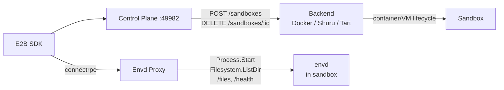

# Sandbox

E2B-compatible sandbox control plane. Use the standard [E2B SDK](https://github.com/e2b-dev/e2b) with local Docker containers, Shuru microVMs, or Tart macOS VMs — swap to real E2B in production by changing one URL.

## Backends

| | Docker | Shuru | Tart |
|---|---|---|---|
| **Technology** | Linux containers | macOS microVMs (Apple Virt) | macOS VMs (Apple Virt) |
| **Platform** | All | macOS only | macOS only |
| **Guest OS** | Linux | Alpine Linux | macOS |
| **Isolation** | Namespace/cgroup | Hardware VM | Hardware VM |
| **Pause/resume** | Yes | No (ephemeral) | Yes (suspend/resume) |
| **Status** | Default | Supported | Supported |

See [docs/container-runtimes.md](docs/container-runtimes.md) for detailed backend comparison.

## Quick Start

### Docker (default)

```bash
# Build the base image
docker build -t sandbox-base:latest docker/sandbox

# Install
brew install circlesac/tap/sandbox
# or: npx @circlesac/sandbox

# Start (auto-generates API key on first run)
sandbox serve
```

### Persistent OrbStack control plane

To run the control plane itself in Docker on macOS, start OrbStack at login and
launch the sandbox service with the OrbStack Docker context:

```bash
docker --context orbstack build -t sandbox-base:latest docker/sandbox
docker --context orbstack compose build --no-cache sandbox
docker --context orbstack compose up -d sandbox
```

The Compose service mounts the Docker socket and `~/.sandbox`, listens on the
host's port `49982`, and uses `restart: always` so OrbStack restores it after
login or reboot. Use `docker --context orbstack compose ps sandbox` and
`sandbox status` to verify both the container and the E2B control plane.

The service intentionally uses `restart: always`, not `unless-stopped`, so it
returns whenever the OrbStack Docker engine starts.

### Shuru (Linux microVMs on macOS)

```bash
brew install superhq-ai/tap/shuru
# Create the sandbox-base checkpoint with envd: see docs/container-runtimes.md

# Set backend
# ~/.sandbox/config.json → { "backend": "shuru" }
sandbox serve
```

### Tart (macOS VMs)

```bash
# Install Tart and pull macOS base image (~24GB, one-time)
brew install cirruslabs/cli/tart
tart clone ghcr.io/cirruslabs/macos-sequoia-base:latest sandbox-base

# Build and install envd-lite into base image (one-time)
cd envd-lite
go generate ./...
go build -o envd-lite .
# See CONTRIBUTING.md for base image setup with envd-lite pre-installed

# Start with macOS support alongside Docker
SANDBOX_MACOS_BACKEND=tart sandbox serve
```

envd-lite is pre-installed in the base image with a LaunchAgent, so each sandbox only needs to clone the VM and boot it. VM creation takes ~30-60s depending on host CPU.

### Public endpoint for a local control plane

When a remote Padawan, Worker, or test runner needs to reach a local control
plane, run `cloudflared` in the same Docker Compose project. Derive a stable
per-device hostname from the Mac's hardware serial so multiple machines do not
claim the same DNS record:

```bash
SANDBOX_DEVICE_HASH="$(printf '%s' "$(ioreg -rd1 -c IOPlatformExpertDevice | awk -F'"' '/IOPlatformSerialNumber/{print $4}')" | shasum -a 256 | cut -c1-8)"
SANDBOX_TUNNEL_NAME="sandbox-${SANDBOX_DEVICE_HASH}"
SANDBOX_PUBLIC_HOSTNAME="sandbox-${SANDBOX_DEVICE_HASH}.crcl.es"

# One-time Cloudflare setup. `login` writes the local management certificate;
# the token file is the only credential mounted into the runtime container.
cloudflared tunnel login
cloudflared tunnel create "$SANDBOX_TUNNEL_NAME"
cloudflared tunnel route dns "$SANDBOX_TUNNEL_NAME" "$SANDBOX_PUBLIC_HOSTNAME"
cloudflared tunnel token "$SANDBOX_TUNNEL_NAME" > ~/.sandbox/cloudflared-tunnel-token
chmod 600 ~/.sandbox/cloudflared-tunnel-token

docker --context orbstack compose up -d cloudflared
docker --context orbstack compose ps sandbox cloudflared
curl -fsS "https://${SANDBOX_PUBLIC_HOSTNAME}/health"
```

The `cloudflared` container routes the tunnel to `http://localhost:49982`, uses
host networking, waits for the sandbox health check, and has `restart: always`,
so OrbStack restores both services after login or reboot. Never commit
the token file or pass it on the command line.

Use `https://sandbox-${SANDBOX_DEVICE_HASH}.crcl.es` for both the E2B SDK's `apiUrl`
and `sandboxUrl`. This is a physical-device naming convention for the control
plane, not a Docker-only or per-container hostname.

## Usage

The E2B SDK works the same across all backends. Use `metadata.platform` to select the platform:

```typescript
import Sandbox from "e2b";

const opts = {
  apiUrl: "http://localhost:49982",
  apiKey: "e2b_...",
};

// Linux sandbox (default)
const linux = await Sandbox.create("base", opts);
const result = await linux.commands.run("uname");
// → "Linux"

// macOS sandbox
const macos = await Sandbox.create("base", {
  ...opts,
  metadata: { platform: "macos" },
});
const result2 = await macos.commands.run("sw_vers -productName");
// → "macOS"
```

Recent E2B SDKs validate keys as `e2b_` followed by 40 hex characters before
making a request. `sandbox serve` generates keys in that format. A config
created before this change holds an `sk-sandbox-*` key: replace it with a key in
the new format, or set `validateApiKey: false` on the client. The flag disables
only the SDK's local format check; the control plane still authenticates the
key. For Padawan's PTY smoke with an older key, use the equivalent environment
setting:

```bash
E2B_VALIDATE_API_KEY=false \
SANDBOX_API_URL=http://localhost:49982 \
SANDBOX_API_KEY="$(jq -r .apiKey ~/.sandbox/config.json)" \
bun run smoke:pty
```

## E2B compatibility

`sandbox` follows the E2B API and SDK, tested with the lowest supported SDK (the floor of the `e2b` range in `cli/package.json`, now 2.31.0) and the latest release by `bun run test:sdk-matrix`. A request option that a backend cannot honor is rejected with a 400 that names it; an E2B API this server does not provide answers 501. Nothing is silently ignored, except where noted below.

| Feature | Docker | Tart (macOS) | Shuru |
| --- | --- | --- | --- |
| Create, commands, PTY, files | Yes | Yes | Yes |
| envd access token (every sandbox is secure; `secure: false` is ignored, as in E2B) | Enforced by envd | Enforced by envd-lite and the control plane | Enforced by the control plane |
| Timeout kills the sandbox (E2B default) | Yes | Yes | Yes |
| `onTimeout: "pause"` / `Sandbox.pause()`, keeping memory | Yes (container frozen) | Yes (VM suspended); where the host cannot save VM state, the VM stops and keeps only its disk | 400 |
| Filesystem-only pause (`autoPauseMemory: false`, `memory: false`) | Yes (container stopped) | 400 | 400 |
| `autoResume` on traffic | Yes | Yes | No pause, so 400 |
| Any port via `getHost(port)` or `E2b-Sandbox-Port` | Yes on Linux and OrbStack; not Docker Desktop for Mac | Yes | envd's port only |
| `network.allowPublicTraffic: false` | Yes | Yes | Yes |
| Egress rules, `allowInternetAccess: false`, `maskRequestHost` | 400 | 400 | 400 |
| Template builds, tags, aliases, delete | Yes (Docker image builds) | Templates are Docker images, so they start on Docker only | 400 when Shuru is the Linux backend |
| Snapshots (IDs are `<name>:<tag>`, tag `default`) | Filesystem only | 400 | 400 |
| `Sandbox.fork()` (15 s default timeout, 409 for a paused sandbox) | Filesystem only; processes start anew | 400 | 400 |
| Metrics | Current sample, no history | Current sample, no history | Current sample, no history |
| MCP gateway, IAM tokens, volume mounts | 400 | 400 | 400 |
| Volumes and secrets APIs | 501 | 501 | 501 |

Known differences that are not errors:

- `getHost(port)` returns `<port>-<sandboxId>.<host the client used>`, for example `3000-sbx-abc.localhost:49982`. Browsers and curl resolve `*.localhost`; behind a public hostname, the extra subdomain level needs a wildcard certificate that covers it, so header routing (`E2b-Sandbox-Id` and `E2b-Sandbox-Port`) is the dependable route.
- WebSocket upgrades to sandbox ports are not proxied.
- The `Idempotency-Key` header on create is not honored; a retried create can start a second sandbox.
- Sandboxes created before lifecycles were recorded keep their old behavior: pause by stopping on timeout.
- Docker reports the envd version in each image (0.10.2 in the base image), so the SDK uses what that envd supports; Tart reports envd-lite's 0.5.3.

## Architecture



See [CONTRIBUTING.md](CONTRIBUTING.md) for development setup and project structure.
